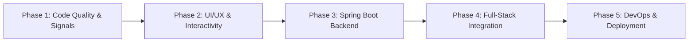

# Portfolio Improvement Roadmap & Full-Stack Implementation Plan

**Project:** `personal-portfolio-Angular-javaFullStack`  
**Author:** Araf  
**Target Architecture:** Angular 22 (Standalone + Signals) + Java 21 / Spring Boot 3 + PostgreSQL  
**Document Version:** 1.0.0  
**Created Date:** October 2026  

---

## 1. Executive Summary

This roadmap outlines the end-to-end strategy to transform the current static Angular portfolio into a true, production-grade, enterprise-ready **Java Full-Stack Portfolio Application**. It addresses code quality debt, modernizes Angular state management with Signals, introduces interactive UI/UX features, and establishes a robust Spring Boot microservice backend for dynamic data handling, contact processing, spam mitigation, and notification delivery.

---

## 2. Current State Analysis

| Area | Current State | Target Future State |
| :--- | :--- | :--- |
| **Backend** | Missing / purely hardcoded static mocks in `PortfolioService` | Dedicated Spring Boot 3 REST API (`/backend` module) |
| **Data Persistence** | None (ephemeral memory) | PostgreSQL (Prod) / H2 (Dev) with Spring Data JPA |
| **Angular Architecture** | Angular 22 standalone, but using plain object state | Fine-grained reactivity with Angular `signal()`, `computed()`, and `toSignal()` |
| **Contact Form** | Static mock with `setTimeout(..., 900)` | Real REST endpoint with validation, rate limiting, and email/webhook alerts |
| **Projects Showcase** | Static grid, placeholder `#` links, no search/filtering | Interactive category tag filtering, live text search, dynamic modals |
| **Navigation** | Basic scroll offset listener without section highlight | Precision Active Scrollspy highlighting current viewport section |
| **Unit Testing** | Broken Vitest test (`app.spec.ts` title mismatch) | 100% passing test suite across components and backend controllers |
| **DevOps / Deployment** | Local manual build only | Multi-stage Dockerized containers with `docker-compose.yml` |

---

## 3. Phased Implementation Roadmap



---

### Phase 1: Immediate Fixes & Modern Angular Signals Migration

#### 1.1 Fix Broken Unit Test
* **File:** `src/app/app.spec.ts`
* **Issue:** Default Angular boilerplate asserts `Hello, portfolio` on `h1`, whereas the updated template renders `Full-Stack Software Developer`.
* **Action:** Update test fixture expectations to match the actual rendered DOM.

#### 1.2 Transition to Modern Angular Signals
* Refactor `PortfolioService` to expose reactive signals:
  ```typescript
  readonly profile = signal<ProfileData>(...);
  readonly projects = signal<Project[]>(...);
  readonly skillCategories = signal<SkillCategory[]>(...);
  ```
* Leverage `computed()` for derived state such as featured projects, filtered lists, and category counts.
* Adopt `input()` and `output()` API for child components where applicable.

---

### Phase 2: Frontend UI/UX & Interactivity Enhancements

#### 2.1 Active Scrollspy in Navbar
* Track viewport intersection for `#hero`, `#about`, `#skills`, `#projects`, and `#contact`.
* Dynamically apply the `.active` gradient underline and glow to the current section link in `Navbar`.

#### 2.2 Interactive Projects Filter & Search
* **Category Pills:** Filter projects by tags (`All`, `Spring Boot`, `Angular`, `Mobile`, `Databases`).
* **Live Search:** Reactive debounced search box filtering projects by title, subtitle, and technology keywords.
* **Empty State:** High-contrast fallback card when no search criteria match.

#### 2.3 Interactive Skills Matrix
* Add proficiency indicators (e.g., visual level bars or skill badge highlights).
* Category tab switching to toggle between Frontend, Backend, Databases, and Mobile domains.

#### 2.4 Resume / CV Download Action
* Add a **"Download Resume"** CTA in both the Hero section and Navbar.
* Link to a downloadable PDF (`public/documents/Araf-Resume.pdf`) and provide an in-browser preview modal option.

#### 2.5 Toast Notification System
* Build a standalone, floating toast service (`ToastService`) to replace raw inline status alerts on contact form submission.

---

### Phase 3: Spring Boot 3 Backend Architecture

#### 3.1 Project Structure
Create a dedicated backend service inside the repository (`backend/`):
```text
backend/
├── pom.xml (or build.gradle)
├── src/main/java/com/araf/portfolio/
│   ├── PortfolioBackendApplication.java
│   ├── config/
│   │   ├── CorsConfig.java
│   │   ├── SecurityConfig.java
│   │   └── OpenApiConfig.java
│   ├── controller/
│   │   ├── ContactController.java
│   │   ├── ProjectController.java
│   │   └── SkillController.java
│   ├── model/
│   │   ├── ContactMessage.java
│   │   ├── Project.java
│   │   └── Skill.java
│   ├── repository/
│   │   ├── ContactMessageRepository.java
│   │   └── ProjectRepository.java
│   └── service/
│       ├── ContactService.java
│       ├── NotificationService.java
│       └── ProjectService.java
└── src/main/resources/
    ├── application.yml
    └── db/migration/ (or schema.sql)
```

#### 3.2 Core Backend Features
1. **REST Endpoints:**
   * `GET /api/v1/profile` — Developer profile and bio metadata.
   * `GET /api/v1/skills` — Skills categories and matrix.
   * `GET /api/v1/projects` — Filterable project catalogue (`?tag=...&featured=true`).
   * `POST /api/v1/contact` — Submits, validates, and stores recruiter/client inquiries.
2. **Spam Mitigation & Security:**
   * Honeypot input field check (`bot_field`).
   * IP-based rate limiting using Bucket4j (e.g., max 5 contact submissions per hour per IP).
   * Strict validation annotations (`@NotBlank`, `@Email`, `@Size(max = 2000)`).
3. **Automated Notification Service:**
   * Dispatch instant alert upon message submission via:
     * Spring Boot Mail (`JavaMailSender`), OR
     * Webhook dispatch (Telegram Bot API, Discord Webhook, or Slack Incoming Webhook).
4. **OpenAPI / Swagger Documentation:**
   * Interactive API playground available at `http://localhost:8080/swagger-ui.html`.

---

### Phase 4: Full-Stack Client-Server Integration

#### 4.1 Angular HttpClient Layer
* Configure `provideHttpClient(withFetch())` in `src/app/app.config.ts`.
* Inject `HttpClient` in `PortfolioService` to load live data with fallback to offline mock data if the backend is unreachable.

#### 4.2 Reactive Contact Form Handling
* Migrate `Contact` component to Angular `ReactiveFormsModule` (`FormGroup`, `FormControl`, `Validators`).
* Connect `onSubmit()` to `POST /api/v1/contact` with loading spinners, disable states, and toast notifications on success/error.

---

### Phase 5: DevOps, SEO & Production Deployment

#### 5.1 Docker Orchestration (`docker-compose.yml`)
* **Frontend Service:** Multi-stage build (Node 22 build -> Nginx alpine image serving optimized static assets and proxying `/api/` calls).
* **Backend Service:** Multi-stage build (Eclipse Temurin JDK 21 -> JRE lightweight runner).
* **Database Service:** PostgreSQL 16 container with automated schema volume persistence.

#### 5.2 SEO & Social Previews
* Add OpenGraph tags (`og:title`, `og:description`, `og:image`, `og:url`) to `src/index.html`.
* Implement Google JSON-LD structured schema for `SoftwareEngineer` / `Person`.
* Add custom web icons and mobile web app manifests.

---

## 4. Verification & Testing Strategy

| Step | Verification Method | Pass Criteria |
| :--- | :--- | :--- |
| **Unit Testing** | `npm test -- --watch=false` | All Angular Vitest component tests pass cleanly. |
| **Build Check** | `npm run build` | Zero build errors; optimized bundle size. |
| **Backend Tests** | `./mvnw clean test` | Controller, repository, and service tests pass. |
| **End-to-End API** | `curl -X POST /api/v1/contact ...` | Message persisted to DB and webhook/notification received. |
| **Docker Compose** | `docker compose up --build` | Frontend, backend, and database start seamlessly and communicate. |

---

## 5. Recommended Execution Order

1. **Step 1:** Fix the broken Angular unit test in `src/app/app.spec.ts`.
2. **Step 2:** Implement frontend UX improvements (Navbar Scrollspy, Project filtering & search, CV download).
3. **Step 3:** Scaffold the Spring Boot 3 backend application with PostgreSQL and REST endpoints.
4. **Step 4:** Integrate Angular `HttpClient` with the backend and add the notification/email dispatch.
5. **Step 5:** Write Dockerfiles and `docker-compose.yml` for unified local and production deployment.
